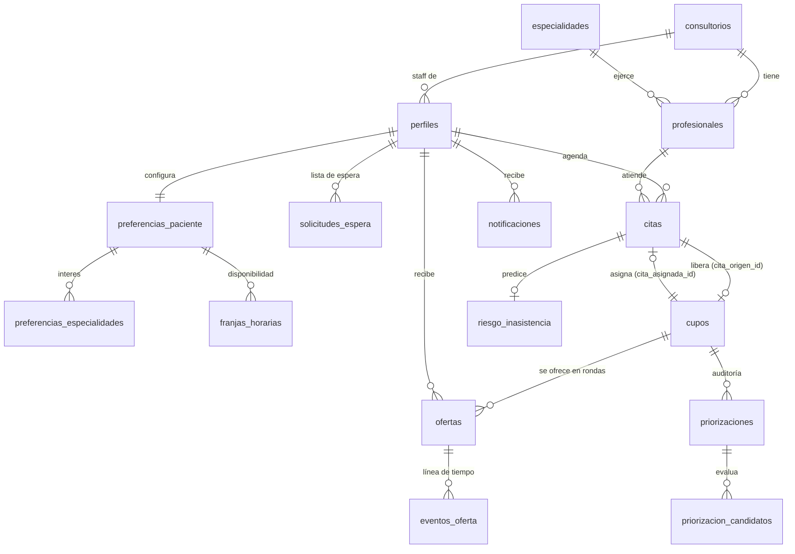

# Base de datos

Backend de TurnoSmart en Supabase (Postgres 17). Replica las reglas del servidor
simulado de la Fase 2 ([flujos.md](flujos.md)): mismas máquinas de estado, mismos
plazos, misma regla de priorización. Las RPC y la Edge Function están en
[api.md](api.md).

## Migraciones

`supabase/migrations/`, en orden:

| Archivo                            | Contenido                                                                                     |
| ---------------------------------- | --------------------------------------------------------------------------------------------- |
| `…120000_extensiones_y_utilidades` | `btree_gist`, `pg_cron`, esquema `private`, reglas de tiempo, `puede_transicionar()`, errores |
| `…120100_esquema_dominio`          | Tablas, restricciones, índices y triggers (transiciones, eventos, perfil al registrarse)      |
| `…120200_rls_y_permisos`           | RLS en todas las tablas y privilegios mínimos                                                 |
| `…120300_priorizacion`             | Filtros de candidatos, puntaje SQL de respaldo y auditoría                                    |
| `…120400_rpc_transaccionales`      | RPC de citas, ofertas, lista de espera, preferencias y el motor de ofertas                    |
| `…120500_cron_y_realtime`          | Trabajo de pg_cron cada minuto y publicación de Realtime                                      |

**Esquemas.** `public` tiene las tablas y las funciones que se llaman por la API.
`private` tiene las reglas internas: PostgREST no lo publica, así que no se puede
llamar desde la app.

## Modelo

Una tabla por interfaz de `src/types/dominio.ts`, en `snake_case`. Ids `uuid`, fechas
`timestamptz` (UTC).



| Tabla                         | Para qué                                                        | Reglas clave                                                                                                                                        |
| ----------------------------- | --------------------------------------------------------------- | --------------------------------------------------------------------------------------------------------------------------------------------------- |
| `consultorios`                | Sedes                                                           | `zona_horaria` (por defecto `America/Bogota`): define el día y la hora local de los cupos                                                           |
| `especialidades`              | Catálogo                                                        | Nombre único                                                                                                                                        |
| `profesionales`               | Profesional de una especialidad en una sede                     | `UNIQUE (id, especialidad_id, consultorio_id)` para las FK compuestas                                                                               |
| `perfiles`                    | 1:1 con `auth.users`                                            | Staff ⇔ tiene consultorio; ubicación aproximada solo de pacientes; `codigo` `P-XXXX` generado                                                       |
| `preferencias_paciente`       | Distancia máxima y antelación mínima                            | Solo las opciones de la app (`2, 5, 10, 20` km o sin límite; `1, 2, 4, 12, 24` h)                                                                   |
| `preferencias_especialidades` | Especialidades de interés                                       | PK compuesta                                                                                                                                        |
| `franjas_horarias`            | Disponibilidad semanal                                          | Inicio < fin; `EXCLUDE` impide franjas solapadas el mismo día (tocarse en el borde se permite)                                                      |
| `solicitudes_espera`          | Lista de espera                                                 | Índice único parcial: una solicitud **activa** por paciente y especialidad                                                                          |
| `citas`                       | Agenda                                                          | FK compuesta al profesional (sede y especialidad coherentes); `cancelada_en` ⇔ cancelada; una cita por cupo                                         |
| `cupos`                       | `CupoLiberado`                                                  | **`UNIQUE (cita_origen_id)`**: una cita libera como máximo un cupo; `asignado` ⇔ `cita_asignada_id`                                                 |
| `ofertas`                     | Oferta de un cupo a un paciente                                 | Índices únicos parciales: **una pendiente por cupo** y **una pendiente por paciente**; nadie recibe dos veces el mismo cupo; `explicacion` validada |
| `eventos_oferta`              | Línea de tiempo del cupo                                        | La llena un trigger en cada creación y cambio de estado                                                                                             |
| `notificaciones`              | Avisos en la app                                                | El cliente solo puede marcarlas como leídas                                                                                                         |
| `priorizaciones`              | Cada cálculo de candidatos: origen, regla, pesos y resultado    | `oferta_creada` ⇔ `oferta_id`                                                                                                                       |
| `priorizacion_candidatos`     | Ranking evaluado, con puntaje, explicación y motivo de descarte | Un elegido por priorización                                                                                                                         |
| `riesgo_inasistencia`         | Predicción para el staff (Fase 5: IA)                           | Nivel coherente con el puntaje (bajo < 0,35 ≤ medio < 0,6 ≤ alto); sin datos clínicos                                                               |

`consultorio_id` se copia en `ofertas`, `eventos_oferta` y `priorizaciones` para que
RLS filtre sin joins; las FK compuestas `(cupo_id, consultorio_id)` garantizan que la
copia siempre coincide con la del cupo.

## Estados

Las máquinas son las de `src/constants/estados.ts` (diagramas en
[flujos.md](flujos.md#máquinas-de-estado)). En el servidor:

- `private.puede_transicionar(maquina, desde, hacia)` es la fuente única.
- Un trigger `BEFORE UPDATE OF estado` en `ofertas`, `citas`, `cupos` y
  `solicitudes_espera` rechaza cualquier transición no listada con
  `transicion_invalida`, venga de una RPC, del cron o de la service role.
- Un `CHECK` en cada tabla limita los valores posibles.
- La prueba `src/__tests__/paridad-backend.test.ts` compara las transiciones, los
  plazos, las opciones de preferencias y los pesos de la app con los de las
  migraciones: si se cambia una sola copia, falla.

| Regla                            | Valor                                  | Función SQL                    |
| -------------------------------- | -------------------------------------- | ------------------------------ |
| Plazo para responder una oferta  | 15 min (o hasta 30 min antes del cupo) | `private.duracion_oferta()`    |
| Cierre del cupo antes de la cita | 30 min                                 | `private.margen_cierre_cupo()` |

## Seguridad: RLS y privilegios

Todas las tablas tienen RLS. Además, el cliente (`authenticated`) solo tiene
`SELECT`; la única escritura directa es `UPDATE (leida)` en `notificaciones`. Todo lo
demás pasa por RPC `SECURITY DEFINER` que validan quién llama. `anon` no tiene acceso.
Se revocó `TRUNCATE` (que ignora RLS) y el `EXECUTE` que Supabase concede por defecto.

| Tabla                                                                                | Paciente                               | Staff                                          |
| ------------------------------------------------------------------------------------ | -------------------------------------- | ---------------------------------------------- |
| `consultorios`, `especialidades`, `profesionales`                                    | Todo (catálogo)                        | Todo (catálogo)                                |
| `perfiles`                                                                           | El suyo                                | El suyo (pacientes: `referencias_pacientes()`) |
| `preferencias_*`, `franjas_horarias`, `solicitudes_espera`                           | Las suyas                              | —                                              |
| `citas`                                                                              | Las suyas                              | Las de su consultorio                          |
| `cupos`                                                                              | Los que le ofrecieron o liberó su cita | Los de su consultorio                          |
| `ofertas`                                                                            | Las suyas                              | Las de su consultorio                          |
| `eventos_oferta`, `priorizaciones`, `priorizacion_candidatos`, `riesgo_inasistencia` | —                                      | Los de su consultorio                          |
| `notificaciones`                                                                     | Las suyas (y marcarlas leídas)         | Las suyas                                      |

- **Privacidad.** El staff nunca lee `perfiles` de pacientes: `referencias_pacientes()`
  devuelve solo `codigo` e iniciales de los pacientes relacionados con su consultorio.
- **Destinatarios.** Ningún cliente puede insertar ofertas ni cambiar su paciente: el
  motor (`ofrecer_siguiente_candidato`, `expirar_ofertas`, `avanzar_cupos`) solo lo
  ejecuta `service_role` o el cron.
- **Roles.** El registro público siempre crea pacientes. El rol staff y su consultorio
  solo pueden venir de `app_metadata`, que el cliente no puede escribir.
- **Funciones nuevas.** Supabase concede `EXECUTE` a `anon` y `authenticated` sobre
  cada función nueva de `public`: toda migración que agregue una debe revocarlo y
  conceder solo lo necesario (ver el final de `…120400_rpc_transaccionales.sql`).

## Concurrencia e idempotencia

- **Orden de bloqueo único:** cupo → sus ofertas (`FOR UPDATE`). Ninguna función
  bloquea en el orden inverso, así que no hay interbloqueos.
- **Doble aceptación:** la segunda respuesta espera el bloqueo del cupo y, al
  continuar, ve la oferta ya respondida (`oferta_ya_respondida`). Además hay un índice
  único de una cita por cupo.
- **Idempotencia por cupo:** `ofrecer_siguiente_candidato` no crea una segunda oferta
  si hay una vigente (`ya_ofertado`); `cancelar_cita` usa `ON CONFLICT (cita_origen_id)`.
- **Mismo candidato para dos cupos:** el índice único "una pendiente por paciente"
  hace fallar la segunda inserción; la función descarta a ese candidato
  (`oferta_pendiente_en_otro_cupo`) y prueba con el siguiente.
- El cron y `avanzar_cupos` usan `SKIP LOCKED`: si otro proceso trabaja un cupo, lo
  retoman al minuto siguiente.

`supabase/tests/database/05_concurrencia.test.sql` lo prueba con dos sesiones reales
(`dblink`).

## Priorización determinista

| Pieza                 | Dónde                                        | Qué hace                                                                                                                                                            |
| --------------------- | -------------------------------------------- | ------------------------------------------------------------------------------------------------------------------------------------------------------------------- |
| Filtros obligatorios  | `private.candidatos_cupo()`                  | Lista de espera o interés, no canceló la cita, no recibió ya este cupo, sin otra oferta pendiente, sin cruce de citas, antelación, distancia y franjas (hora local) |
| Puntaje + explicación | `supabase/functions/_shared/priorizacion.ts` | Regla en TypeScript que usa la Edge Function `priorizar-cupo`                                                                                                       |
| Puntaje de respaldo   | `private.puntuar_candidatos()`               | La misma regla en SQL, para el cron y si una propuesta no sirve                                                                                                     |
| Auditoría             | `priorizaciones`, `priorizacion_candidatos`  | Ronda, origen (`edge_function` o `sql`), versión, pesos, ranking y resultado                                                                                        |
| Decisión final        | `public.ofrecer_siguiente_candidato()`       | Revalida cada candidato propuesto bajo bloqueo y crea la oferta                                                                                                     |

**Puntaje** = Σ valor × peso, cada valor entre 0 y 1 con 3 decimales:

| Factor                 | Peso | Valor                                                  |
| ---------------------- | ---- | ------------------------------------------------------ |
| Tiempo de espera       | 0,4  | días en la lista / 30 (máximo 1); 0 si solo es interés |
| Compatibilidad horaria | 0,3  | 1 dentro de una franja; 0,5 sin franjas                |
| Distancia              | 0,2  | 1 − km / 20 (mínimo 0); 0,5 si no se conoce la zona    |
| Historial de respuesta | 0,1  | aceptadas / respondidas; 0,5 sin historial             |

Orden: puntaje descendente; en empate, quien espera hace más tiempo; después el id
(orden total y estable). La explicación guardada en la oferta tiene la forma de
`ExplicacionPrioridad` con `fuente = 'regla_backend'`; un `CHECK` la valida.

Las dos implementaciones del puntaje se prueban con el **mismo** escenario y los mismos
resultados esperados (`04_priorizacion.test.sql` y `_shared/priorizacion.test.ts`).
Cómo y cuándo se dispara: [api.md](api.md#cuándo-se-prioriza-un-cupo).

## Datos de prueba (`supabase/seed.sql`)

⚠️ Ficticios y solo para el entorno local. Mismo escenario que
`src/services/mock/semilla.ts`, con fechas relativas al momento del reset (hora de
Bogotá). Al final cancela dos citas con las funciones reales, lo que genera las
ofertas "en vivo" de Mariana (Medicina general) y Pedro (Pediatría).

| Correo                           | Rol                      | Contraseña |
| -------------------------------- | ------------------------ | ---------- |
| `paciente@demo.turnosmart.co`    | Paciente (Mariana Rojas) | `demo1234` |
| `carlos@demo.turnosmart.co`      | Paciente (Carlos Pérez)  | `demo1234` |
| `staff@demo.turnosmart.co`       | Staff, Sede Centro       | `demo1234` |
| `staff.norte@demo.turnosmart.co` | Staff, Sede Norte        | `demo1234` |

También existen `ana@`, `jorge@`, `lucia@` y `pedro@demo.turnosmart.co`. Las ofertas
vencen a los 15 minutos (el cron las avanza): `supabase db reset` regenera el escenario.

## Entorno local

Requisitos: Docker y la [CLI de Supabase](https://supabase.com/docs/guides/local-development/cli/getting-started).
No se enlaza ningún proyecto remoto ni se usan secretos: las claves que imprime
`supabase start` son las de desarrollo local.

```bash
supabase start         # npm run db:start — levanta Postgres, Auth, REST, Realtime y Edge Functions
supabase db reset      # npm run db:reset — aplica las migraciones y seed.sql
supabase test db       # npm run test:db  — pruebas pgTAP (supabase/tests/database)
deno test supabase/functions   # npm run test:deno — requiere Deno 2
```

Sin Deno instalado: `docker run --rm -v "$PWD/supabase/functions:/app:ro" -w /app denoland/deno:2.1.4 test`
(misma versión que el runtime local de Edge Functions).

Studio queda en <http://127.0.0.1:54323> para inspeccionar tablas, la auditoría de
priorización y `cron.job_run_details`.
