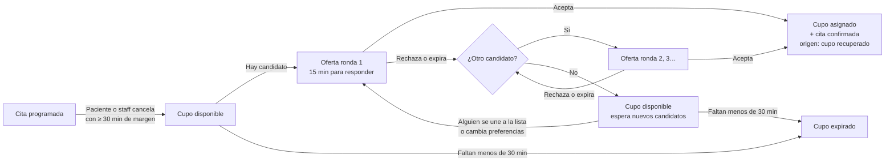
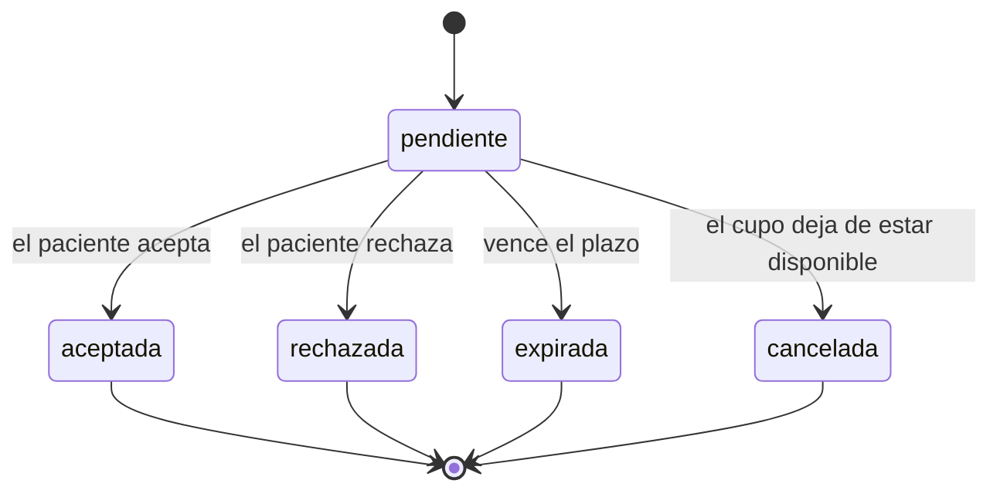
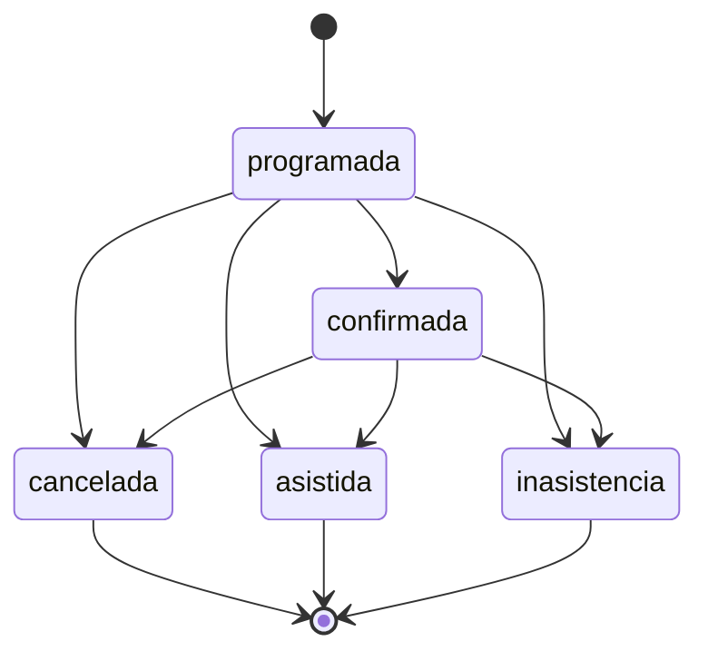
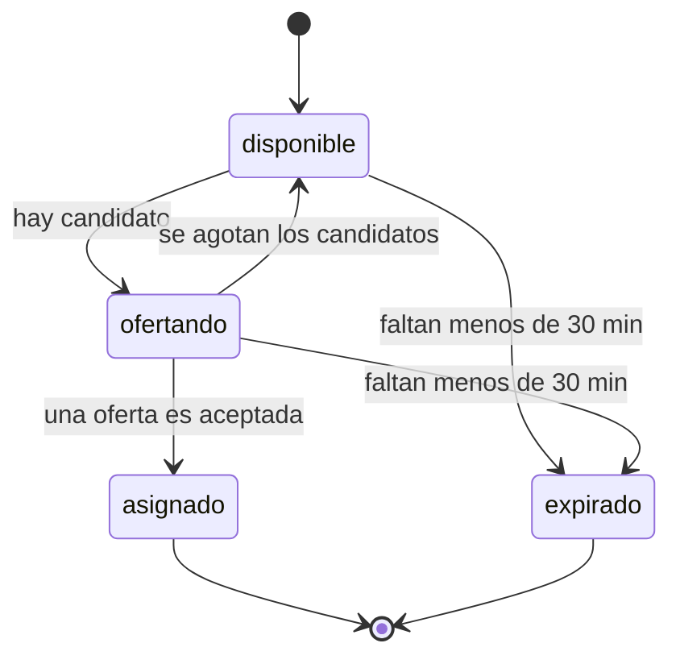
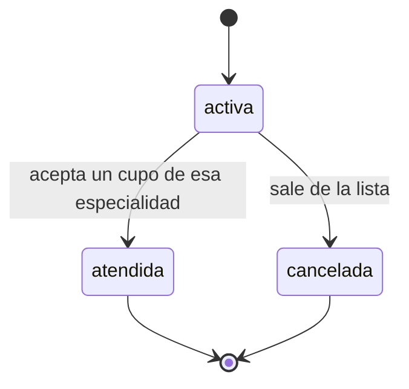

# Flujos y máquinas de estado

Cómo funciona TurnoSmart de punta a punta en la Fase 2 (modo demo, servidor
simulado). Las reglas de este documento están implementadas en
`src/constants/estados.ts`, `src/constants/reglas.ts` y `src/services/mock/`, y
cubiertas por pruebas. En la Fase 3 el backend de Supabase aplicará las mismas
reglas.

## Ciclo de vida de un cupo

1. **Liberación.** Al cancelarse una cita futura se crea **un** cupo (nunca dos para
   la misma cita: la operación es idempotente). Si faltan menos de 30 minutos, la
   cita se cancela pero no se libera un cupo ofertable: nadie alcanzaría a llegar.
2. **Oferta.** El cupo se ofrece al mejor candidato según la
   [regla de priorización](#regla-de-priorización-simulada). El paciente recibe una
   notificación y tiene **15 minutos** (o menos, si el cupo es muy próximo).
3. **Respuesta.** Aceptar crea la cita (estado `confirmada`, origen
   `cupo_recuperado`), asigna el cupo y marca como atendida la solicitud de la lista
   de espera. Rechazar o dejar vencer la oferta pasa el cupo al siguiente candidato
   en una nueva ronda.
4. **Cierre.** Si nadie lo toma antes de 30 minutos de la cita, el cupo expira y su
   oferta pendiente (si la hay) se cancela.

El servidor simulado ejecuta el "cron" (`expirarOfertas()`) antes de cada petición.
En la interfaz, la cuenta regresiva muestra la oferta como expirada al llegar a
cero y pide al servidor el estado real: **el servidor decide; la interfaz solo lo
anticipa.**

## Flujos del paciente

Cuenta demo: `paciente@demo.turnosmart.co` / `demo1234` (botón **Entrar como
paciente demo**). Al abrir la app, Mariana Rojas (ficticia) tiene una oferta
pendiente de Medicina general.

| Flujo                | Dónde                                  | Qué pasa                                                                                                                                                                                                                                                         |
| -------------------- | -------------------------------------- | ---------------------------------------------------------------------------------------------------------------------------------------------------------------------------------------------------------------------------------------------------------------- |
| Ver ofertas          | Pestaña **Ofertas**                    | Ofertas pendientes con cuenta regresiva en vivo. A cero, la tarjeta pasa a "Expirada". Deslizar hacia abajo actualiza.                                                                                                                                           |
| Responder            | Tocar una oferta                       | Detalle (especialidad, profesional, consultorio, fecha y hora, tiempo restante) y "¿Por qué recibí esta oferta?". **Aceptar cupo** o **Rechazar** piden confirmación. Si la oferta venció o el cupo ya no está disponible, se muestra el error y el estado real. |
| Historial de ofertas | Ofertas → **Ver historial de ofertas** | Ofertas aceptadas, rechazadas, expiradas o canceladas.                                                                                                                                                                                                           |
| Lista de espera      | Ofertas → **Lista de espera**          | Unirse a la lista de una especialidad (no permite duplicados), ver las activas y salir con confirmación. Al unirse, si hay un cupo disponible compatible, se ofrece de inmediato.                                                                                |
| Preferencias         | Perfil → **Preferencias**              | Especialidades de interés, franjas por día (inicio anterior al fin y sin solapes), distancia máxima y antelación mínima. Validado con zod en la app y de nuevo en el servidor.                                                                                   |
| Citas                | Pestaña **Citas**                      | Próximas e Historial. Las que salieron de un cupo muestran "Cupo recuperado". Cancelar una cita próxima libera su cupo.                                                                                                                                          |
| Notificaciones       | Pestaña **Avisos**                     | Contador de no leídas en la pestaña. Tocar un aviso lo marca como leído y abre la oferta. "Marcar todas como leídas".                                                                                                                                            |

### "¿Por qué recibí esta oferta?"

Cada oferta guarda su `ExplicacionPrioridad`: cuatro factores con `valor` (0–1),
`peso` y una frase en lenguaje claro, más la fuente (`regla_simulada` en esta fase,
`regla_backend` en la Fase 3, `ia` en la Fase 5). El paciente ve cuánto lo favoreció
cada factor, nunca datos de otros pacientes.

## Flujos del staff

Cuenta demo: `staff@demo.turnosmart.co` / `demo1234` (Sede Centro). Para comprobar
el aislamiento entre consultorios: `staff.norte@demo.turnosmart.co` / `demo1234`.

| Flujo            | Dónde               | Qué pasa                                                                                                                                                                                                                                                                                               |
| ---------------- | ------------------- | ------------------------------------------------------------------------------------------------------------------------------------------------------------------------------------------------------------------------------------------------------------------------------------------------------ |
| Métricas         | Pestaña **Panel**   | Últimos 30 días del consultorio: cancelaciones, cupos liberados, cupos recuperados, tasa de recuperación, ofertas pendientes e inasistencias.                                                                                                                                                          |
| Agenda           | Pestaña **Agenda**  | Citas de hoy y los próximos 7 días, agrupadas por día, con riesgo de inasistencia (bajo, medio o alto) marcado como **estimación ficticia**. **Registrar cancelación** (cita futura) libera el cupo; **Registrar inasistencia** (cita que ya comenzó) queda en el historial. Ambas piden confirmación. |
| Cupos            | Pestaña **Cupos**   | Cupos por estado (filtro) y detalle con la línea de tiempo: ronda, paciente (solo iniciales y código), resultado y horas.                                                                                                                                                                              |
| Ofertas en curso | Pestaña **Ofertas** | Ofertas pendientes con su tiempo restante.                                                                                                                                                                                                                                                             |

**Privacidad.** El staff nunca recibe nombre, correo ni teléfono de los pacientes en
el panel: solo iniciales y un código estable (`P-XXXX`). **Aislamiento.** Toda
operación del staff se limita a su consultorio; lo ajeno responde `no_encontrado`.

## Máquinas de estado

Fuente única de verdad: `src/constants/estados.ts` (`puedeTransicionar()`,
`esEstadoTerminal()`). Una transición no listada lanza `transicion_invalida`.

### Oferta

### Cita

Las citas creadas al aceptar un cupo nacen `confirmada`. Solo se cancela una cita
que no ha comenzado; una que ya comenzó se registra como inasistencia.

### Cupo

### Solicitud de lista de espera

## Regla de priorización simulada

> ⚠️ Simulación de la Fase 2 (`src/services/mock/reglaPriorizacion.ts`). La regla
> real la implementa el backend en la Fase 3 y la IA la complementa en la Fase 5.

**Filtros obligatorios.** Es candidato quien:

- tiene una solicitud activa en la lista de la especialidad o la marcó como
  especialidad de interés;
- no canceló la cita original ni recibió antes una oferta de este cupo;
- no tiene otra oferta pendiente (una a la vez);
- no tiene otra cita activa que se cruce con el horario;
- cumple su antelación mínima, su distancia máxima (si se conoce su zona) y sus
  franjas horarias (si las definió).

**Puntaje** = Σ valor × peso:

| Factor                 | Peso | Valor                                                  |
| ---------------------- | ---- | ------------------------------------------------------ |
| Tiempo de espera       | 0,4  | días en la lista / 30 (máximo 1); 0 si solo es interés |
| Compatibilidad horaria | 0,3  | 1 dentro de una franja; 0,5 sin franjas                |
| Distancia              | 0,2  | 1 − km / 20 (mínimo 0); 0,5 si no se conoce la zona    |
| Historial de respuesta | 0,1  | aceptadas / respondidas; 0,5 sin historial             |

Gana el puntaje más alto; en empate, quien lleva más tiempo esperando.

## Riesgo de inasistencia ficticio

> ⚠️ Estimación ficticia (`src/services/mock/riesgoFicticio.ts`). La predicción
> real la hace la IA desde el backend en la Fase 5. El staff decide qué hacer.

Usa solo el historial de asistencia y si la cita está confirmada (sin datos
clínicos): `0,15 + 0,55 × tasa de inasistencia + 0,15 si no está confirmada + 0,1 si
no hay historial`. Bajo < 0,35 ≤ medio < 0,6 ≤ alto. Cada nivel trae su
recomendación: sin acción, recordatorio el día anterior o llamada de confirmación.

## Errores tipados

Toda implementación de servicios lanza `ServiceError` con un código
(`src/services/errores.ts`); la interfaz muestra el mensaje en español.

| Código                                | Cuándo                                                             | Mensaje                                                          |
| ------------------------------------- | ------------------------------------------------------------------ | ---------------------------------------------------------------- |
| `sin_conexion`                        | Fallo de red (simulable desde Perfil → Herramientas de desarrollo) | No pudimos conectarnos. Revisa tu conexión e inténtalo de nuevo. |
| `credenciales_invalidas`              | Login con correo o contraseña incorrectos                          | El correo o la contraseña no son correctos.                      |
| `email_en_uso`                        | Registro con un correo existente                                   | Ya existe una cuenta con este correo.                            |
| `no_encontrado`                       | Recurso inexistente o de otro usuario o consultorio                | No encontramos lo que buscabas…                                  |
| `prohibido`                           | Un rol usa una operación del otro                                  | No tienes permiso para realizar esta acción.                     |
| `oferta_expirada`                     | Responder una oferta vencida                                       | Esta oferta ya expiró…                                           |
| `oferta_ya_respondida`                | Responder dos veces                                                | Esta oferta ya fue respondida.                                   |
| `cupo_no_disponible`                  | El cupo se cerró antes de responder                                | Este cupo ya no está disponible.                                 |
| `solicitud_duplicada`                 | Unirse dos veces a la misma lista                                  | Ya estás en la lista de espera de esta especialidad.             |
| `transicion_invalida`                 | Cambio de estado no permitido (p. ej. cancelar dos veces)          | Esta acción ya no está disponible para el estado actual.         |
| `cita_ya_comenzo` / `cita_no_comenzo` | Cancelar una cita iniciada / inasistencia de una futura            | Mensajes específicos para el staff.                              |
| `no_autenticado`                      | Sesión inválida: la app cierra la sesión                           | Tu sesión terminó…                                               |

## Reglas de tiempo

| Regla                                    | Valor       | Constante                       |
| ---------------------------------------- | ----------- | ------------------------------- |
| Plazo para responder una oferta          | 15 min      | `DURACION_OFERTA_MIN`           |
| Cierre del cupo antes de la cita         | 30 min      | `MARGEN_CIERRE_CUPO_MIN`        |
| Periodo de las métricas                  | 30 días     | `PERIODO_METRICAS_DIAS`         |
| Refresco de ofertas / contador de avisos | 30 s / 15 s | hooks de `src/features/*/hooks` |
